

  <picture>
    <source media="(prefers-color-scheme: dark)" srcset=".github/assets/glimstone-banner-dark.png">
    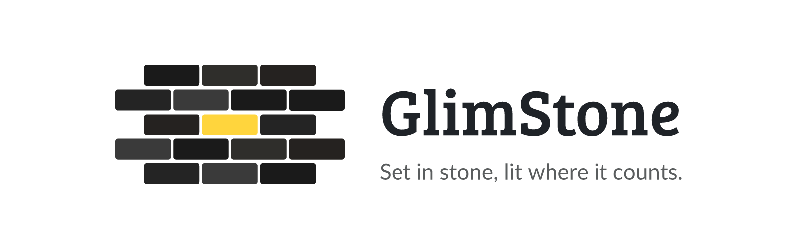
  </picture>

  &nbsp;
  &nbsp;
  &nbsp;
  &nbsp;
  &nbsp;
  &nbsp;
  &nbsp;
  

The shared design language behind a family of apps by the same author: one low-noise palette, 
four engines a user drives from the app root, and a house style for the componentry. 
 
One core without a framework and a package each for React, Vue and Flutter, so a plain-CSS 
Unraid plugin, a React app and a Vue app speak the same language. Published for reference 
rather than for outside adoption; <a href="docs/design-language.md">docs/design-language.md</a> carries the reasoning and everything else.

 

  <a href="https://junkerderprovinz.github.io/glimstone/"><picture><source media="(prefers-color-scheme: dark)" srcset=".github/assets/pictures/components-dark.png">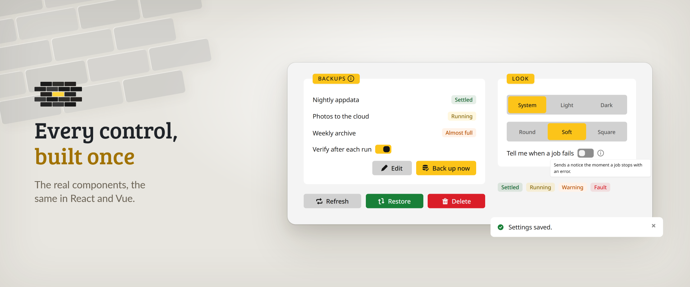</picture></a>
   <em>Buttons, switches, the horizontal selector, badges, cards, a toast and an info bubble, all drawn by the real components.</em>

 

<a id="table-of-contents" href="#table-of-contents"><picture><source media="(prefers-color-scheme: dark)" srcset=".github/assets/sections/table-of-contents-dark.svg"></picture></a>

1. [Support](#1-support)
2. [What's in this repo](#2-whats-in-this-repo)
3. [The short version](#3-the-short-version)
4. [The engines](#4-the-engines)
5. [Easter eggs](#5-easter-eggs)
6. [Adopting GlimStone in an app](#6-adopting-glimstone-in-an-app)
7. [Where per-app detail lives](#7-where-per-app-detail-lives)
8. [Versioning](#8-versioning)
9. [License](#9-license)
10. [How AI is used here](#10-how-ai-is-used-here)

 

<a id="1-support" href="#1-support"><picture><source media="(prefers-color-scheme: dark)" srcset=".github/assets/sections/1-support-dark.svg">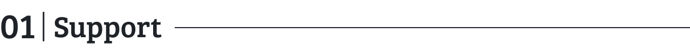</picture></a>

A one-knight job: I build it, keep it running, work through the issues and add what people ask for, until nothing is missing. It is free, with no accounts, no telemetry, no ads and no paid tier. No asterisk anywhere. Nothing readable ever leaves your own walls. Forged on evenings and weekends, with heart and stubbornness.

If it has earned a place on your server or computer, toss a coin to your knight: it helps cover the costs and keeps the project alive. It also makes this knight's heart beat a little faster. Three ways below, whichever suits you.

 

  
  &nbsp;
  
  &nbsp;
  

 

<a id="2-whats-in-this-repo" href="#2-whats-in-this-repo"><picture><source media="(prefers-color-scheme: dark)" srcset=".github/assets/sections/2-whats-in-this-repo-dark.svg">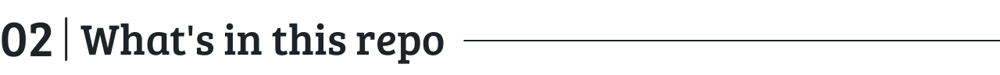</picture></a>

- [`docs/design-language.md`](docs/design-language.md) is the full spec: the palette, the name and its etymology, all the rules, the componentry vocabulary (info bubble, horizontal selector and its vertical tiles, the settings search and the search button, switches, the reveal eye, badges, toasts, empty states, destructive actions, charts, the sidebar and the phone's bottom bar), all four engines, the token contract, and the adoption steps. This is the document to read start to finish; everything below just points back into it.
- The [glossary](https://junkerderprovinz.github.io/glimstone/#/guide/glossary) names every element of GlimStone in English and German, each beside a live example of it, so a design talk and the code use the same words.
- [`site/`](site/) is the documentation site at [junkerderprovinz.github.io/glimstone](https://junkerderprovinz.github.io/glimstone/). It shows every component live under every look a user can pick, its source, its props as the code declares them, and its behaviour contract: the keys, the focus and what a screen reader hears, each row tested on every push with the result printed beside it.
- [`packages/core`](packages/core) is `@glimstone/core`: [`tokens.css`](packages/core/tokens.css), the palette and every component class as plain CSS custom properties, where the shape, colour and motion engines resolve to actual values; the optional [`tailwind-theme.css`](packages/core/tailwind-theme.css), which maps the tokens onto Tailwind v4 utilities; the glyph assortment in [`glyphs.json`](packages/core/glyphs.json) and [`glyphs.md`](packages/core/glyphs.md); and the logic of every engine and component in plain TypeScript. Its parts that run without a framework (the select, the tooltips, the colour picker, the number field's steppers) serve a page such as an Unraid plugin as they are.
- [`packages/react`](packages/react) is `@glimstone/react`, the components for React: `Button`, `Toggle`, `Card`, `Badge`, `ConfirmDialog` with `useConfirm`, `ToastViewport`, `InfoBubble`, `IconTipButton`, `UnavailableNotice`, `ListTable`, `Popover` and `Sheet`, `BusyRing` and `SkeletonRow`, the sign-in card, the fortress's Instances tab and pairing card, the Info tile, the README buttons, the three windows to give, `WindowBar`, and `Select`, `Combobox` and `Slider` on [Zag](https://zagjs.com) state machines from entries of their own.
- [`packages/vue`](packages/vue) is `@glimstone/vue`, the same components for Vue 3, with the engines as composables.
- [`packages/terms`](packages/terms) is `@glimstone/terms`: the words an interface uses for the same thing, such as relay, backup and instance, in all 42 languages with plural and gender, the variants each language avoids, and a check that runs in an app's CI and names every translation that strays, with file and key.
- [`packages/flutter`](packages/flutter) is the Dart package `glimstone`: the tokens as a `ThemeExtension`, the glyphs as a set, and the first widget. Its tokens are written from `tokens.css` by [`scripts/gen-flutter.mjs`](scripts/gen-flutter.mjs).
- [`CHANGELOG.md`](CHANGELOG.md) records what changed in the language itself, versioned.

  <a href="https://junkerderprovinz.github.io/glimstone/#/guide/glossary"><picture><source media="(prefers-color-scheme: dark)" srcset=".github/assets/pictures/glossary-dark.png">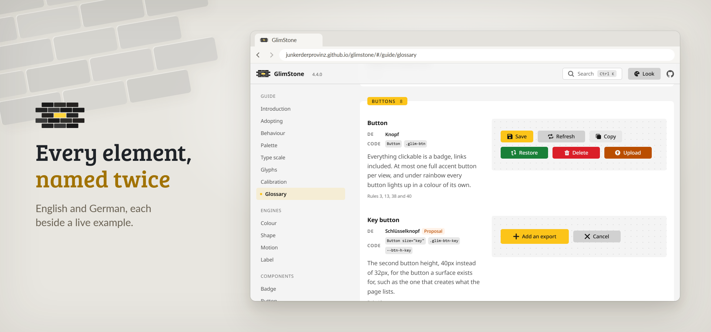</picture></a>
   <em>The glossary names every element in English and German, each beside a live example of it.</em>

The files say what a control must look like; the components say what it **is**. Two apps built from the prose alone produced the same language under different names, one `Toggle` and one `Switch`, one `ConfirmDialog` and one `Confirm`, and a third would have invented a third set. Every string is a prop and no component fetches anything, so the same component serves an app in any language. Install with `npm install @glimstone/core @glimstone/react` (or `@glimstone/vue`) and load `@glimstone/core/tokens.css` first; [the design language](docs/design-language.md#adopting-glimstone-in-another-app) has the rest of the steps.

 

<a id="3-the-short-version" href="#3-the-short-version"><picture><source media="(prefers-color-scheme: dark)" srcset=".github/assets/sections/3-the-short-version-dark.svg">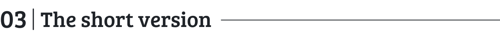</picture></a>

IBM Carbon's neutral greys for the ground and surfaces, one accent that means "this is happening" and nothing else, four state hues total, hierarchy from type and colour rather than borders, and every heading rendered as a filled section badge rather than bare text.

**Six axes belong to the user**: theme, corner shape, accent colour, rainbow, motion intensity and label mode. Every one of them is applied once at the app root, never by the page that edits it. Four resolve through a named engine, so nothing downstream has to know which setting produced the value it got: the **shape engine** (one radius token, no exception list), the **colour engine** (theme, accent and rainbow together), the **motion engine** (one set of duration and distance tokens feeding the same keyframes at every intensity) and the **label engine** (text, glyph or both, across three independent surfaces). Icons come from one shared assortment so a folder is the same folder in every app.

See [`docs/design-language.md`](docs/design-language.md) for the palette table and all the rules with their reasoning. The site's [Rules](https://junkerderprovinz.github.io/glimstone/#/guide/rules) page is built from that list.

 

<a id="4-the-engines" href="#4-the-engines"><picture><source media="(prefers-color-scheme: dark)" srcset=".github/assets/sections/4-the-engines-dark.svg">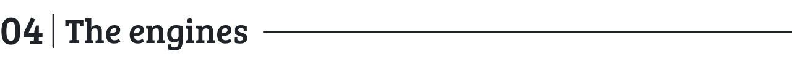</picture></a>

An engine is a single mechanism that turns one setting into every token a component reads, so nothing downstream has to know which setting produced the value it got. All four are applied once at the app root, never by the page that edits them. Otherwise two pages would be free to disagree about how "square" looks.

  <a href="https://junkerderprovinz.github.io/glimstone/#/engines/shape"><picture><source media="(prefers-color-scheme: dark)" srcset=".github/assets/pictures/engine-shape-dark.png">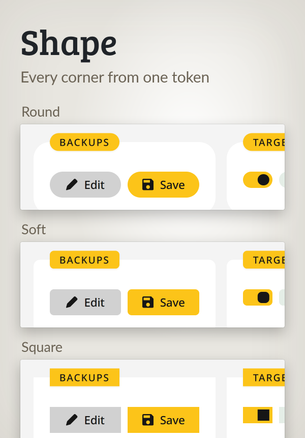</picture></a>
  <a href="https://junkerderprovinz.github.io/glimstone/#/engines/colour"><picture><source media="(prefers-color-scheme: dark)" srcset=".github/assets/pictures/engine-colour-dark.png">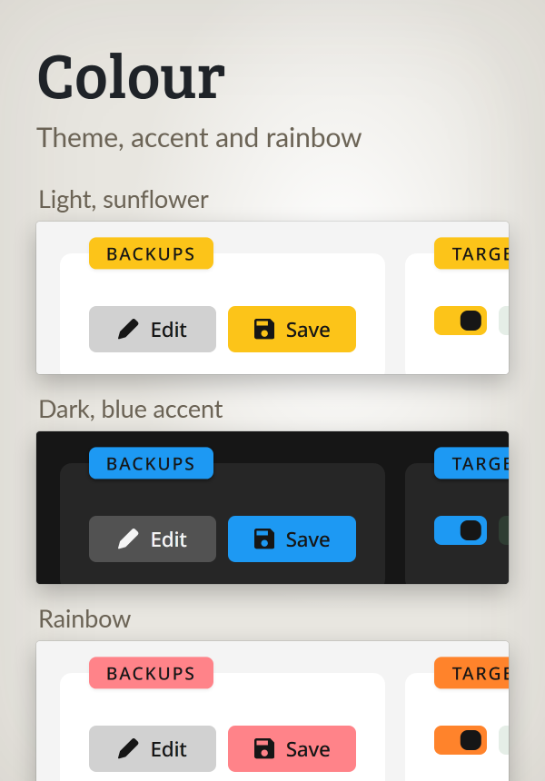</picture></a>
  <a href="https://junkerderprovinz.github.io/glimstone/#/engines/motion"><picture><source media="(prefers-color-scheme: dark)" srcset=".github/assets/pictures/engine-motion-dark.png">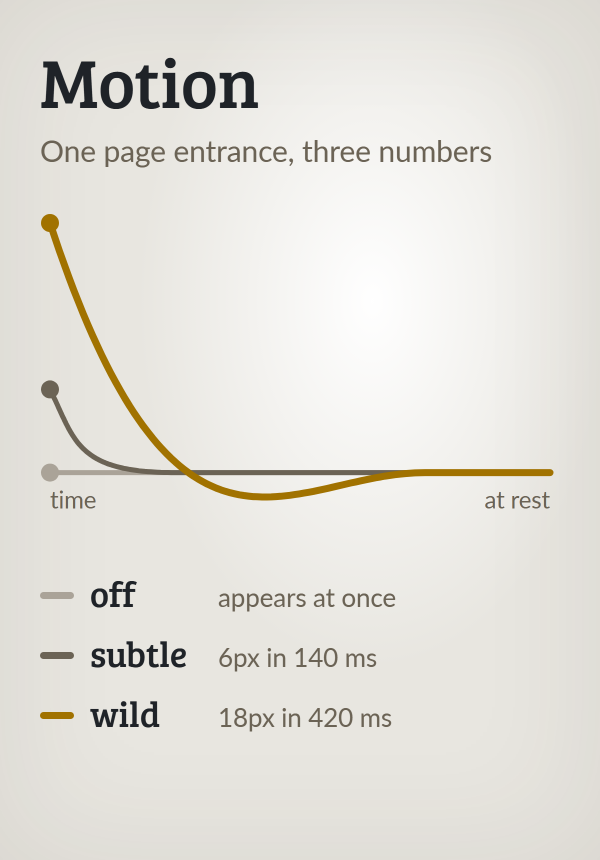</picture></a>
  <a href="https://junkerderprovinz.github.io/glimstone/#/engines/label"><picture><source media="(prefers-color-scheme: dark)" srcset=".github/assets/pictures/engine-label-dark.png">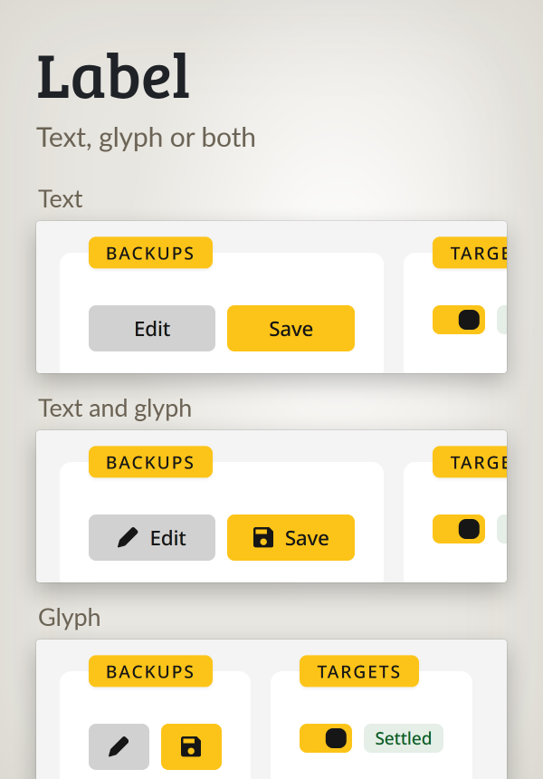</picture></a>
   <em>Each tile is drawn by the engine it shows, from the same tokens an app reads.</em>

| Engine | Drives | Set on `<html>` | Values | Default | Reference |
|---|---|---|---|---|---|
| **Shape** | corner shape | `data-shape` | `round` (card 20px, field 12px, pressable things pills) · `soft` (8/5px) · `square` (0), plus `leaf` below the picker's floor | `soft` | [`tokens.css`](packages/core/tokens.css), [`appearance.ts`](packages/core/src/appearance.ts) |
| **Colour** | theme, OLED, accent, rainbow | `data-theme`, `data-oled`, `--accent` | `light` · `dark` · unset (follows the OS), OLED on whichever dark shows, any accent or `system` (the device's own) with every ink at 4.5:1, eight rainbow positions | system theme, Sunflower gold `#FCC419` | [`tokens.css`](packages/core/tokens.css), [`appearance.ts`](packages/core/src/appearance.ts), [`theme.ts`](packages/core/src/theme.ts), [`contrast.ts`](packages/core/src/contrast.ts), [`browserAccent.ts`](packages/core/src/browserAccent.ts), [`colorPicker.ts`](packages/core/src/colorPicker.ts) |
| **Motion** | motion intensity | `data-motion` | `off` · `subtle` · `wild`, plus `storm` below the picker's floor | `subtle` | [`tokens.css`](packages/core/tokens.css), [`appearance.ts`](packages/core/src/appearance.ts) |
| **Label** | how much of a control is shown | `data-labels-buttons`, `data-labels-sidebar`, `data-labels-tabs` | `text` · `textGlyph` · `glyph` · `reactive` | `textGlyph` | [`controls.ts`](packages/core/src/controls.ts) |

Before adopting them:

- **One token set each, no exception list.** Shape resolves every radius in the app through one token; motion resolves every duration and distance through another, feeding the *same* keyframes at every intensity. "Subtle" and "off" are smaller numbers, not forked animations.
- **Motion composes with `prefers-reduced-motion`, it never overrides it.** The OS signal stays unconditional and still wins; `data-motion` only resolves inside the `no-preference` block. A user who picks "off" without OS-level reduced motion gets the same numbers the reduced-motion block already uses.
- **Language is an axis, not an engine.** It sets `lang` and `dir`, which changes structure rather than resolving to a token set, so it deliberately stays outside this table.

A new control has to point its own CSS at these tokens as it is built. Adopting them is not automatic just because the tokens exist in the file, and the gap is invisible at the defaults: a hard-coded `rounded-full` and a shape-engine-correct `rounded-pill` render identically until somebody switches to square.

 

<a id="5-easter-eggs" href="#5-easter-eggs"><picture><source media="(prefers-color-scheme: dark)" srcset=".github/assets/sections/5-easter-eggs-dark.svg">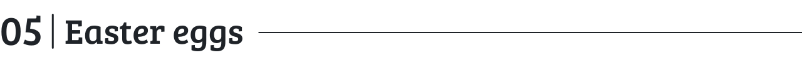</picture></a>

Three settings have a hidden extra that no picker lists. They exist mostly for the rules that come with them, and those rules apply to any egg an adopting app adds.

  <picture><source media="(prefers-color-scheme: dark)" srcset=".github/assets/pictures/easter-eggs-dark.png">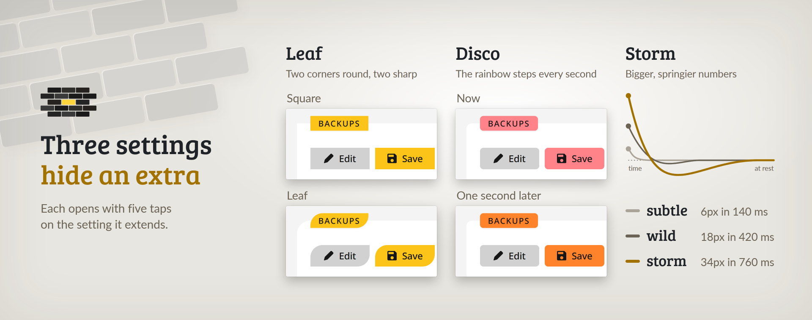</picture>
   <em>Leaf and disco on the real components, storm from the motion engine's own numbers.</em>

| Egg | Setting | How to find it | What it does | Code |
|---|---|---|---|---|
| **Storm** | Motion | Set the motion to `wild`, then tap `wild` five more times. | A fourth motion level: the same animations with bigger, springier numbers. | `stormTap()`, `:root[data-motion='storm']` |
| **Disco** | Rainbow | Turn Rainbow Mode on five times, each within three seconds of the last. | The rainbow colours step one position every second. | `discoTap()`, `applyDisco()` |
| **Leaf** | Corners | Set the shape to `square`, then tap `square` five more times. | A fourth shape: the top-left and bottom-right corners rounded, the other two sharp. | `leafTap()`, `:root[data-shape='leaf']` |

The functions live in [`packages/core/src/appearance.ts`](packages/core/src/appearance.ts) and the token blocks in [`packages/core/tokens.css`](packages/core/tokens.css).

### The rules every egg follows

1. **It can be switched off again and never becomes a permanent setting.** A stored "found it" flag would add the hidden option to the picker for good, and a secret would turn into a setting somebody has to explain to themselves months later. So the option is offered while it is chosen, because a picker that hid the value it shows would be lying, and otherwise only while the settings screen that found it stays open. `found` lives in that screen's state and never in storage. The chosen value is saved like any other setting, so a found storm or leaf survives a reload.
2. **Only a deliberate gesture on the setting it extends opens it.** Tapping an option that is already chosen means wanting more of it. Tapping "off" five times means somebody is annoyed, and a secret that opens under annoyance is a bug report waiting to be filed.
3. **It may outrank reduced motion, but never for anything continuous.** The three motion levels a picker offers always obey the operating system's reduced-motion setting, because somebody who set it never went looking for them; they got whatever the app booted at. A found egg is a deliberate request, so the storm plays in full and disco has no reduced-motion gate. The live-indicator pulse still stops at every level, and disco's one-second step stays well under the 3Hz flicker threshold that photosensitivity guidance names.

### Storm

The same keyframes as the other levels with bigger numbers: a page entrance of 760ms over 34px on `cubic-bezier(.22, 1.94, .45, 1)`, and `springDamping: 0.34` on a phone. One token block is its whole cost.

Its exemption from reduced motion has two halves. It sits in the `reduce` block, which swaps in gentler substitutes rather than switching motion off, and it restores the full animation there. An exemption without the restore would leave the storm with no animation at all, because the real rule lives in the block the media query replaced. Where the resting state is invisible, nothing would appear on screen.

### Disco

Disco animates nothing of its own. It has no keyframes and no new classes; it steps the rotation offset rainbow already carries on a timer, so every hued element moves to the next colour at the same moment. Only turn-ons count toward the gesture, which halves the clicks and leaves rainbow on, the one state in which a walking palette is visible.

### Leaf

The tokens stay single lengths, and one rule sets the top-right and bottom-left radius of every element and pseudo-element to 0. Every `calc()` on a token keeps working, and a phone app gets plain numbers. The corners are physical rather than logical, so the leaf leans the same way in a right-to-left language. Because it is ordinary per-corner radii, it looks the same in every browser, desktop shell and phone app.

An adopting app may add eggs of its own. They belong in that app's own notes, and the rules above apply to them too.

 

<a id="6-adopting-glimstone-in-an-app" href="#6-adopting-glimstone-in-an-app"><picture><source media="(prefers-color-scheme: dark)" srcset=".github/assets/sections/6-adopting-glimstone-in-an-app-dark.svg">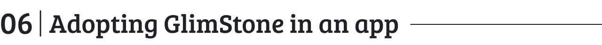</picture></a>

1. Install the core and the framework package: `npm install @glimstone/core @glimstone/react`, or `@glimstone/vue`. Select, Combobox and Slider come from their own entries (`@glimstone/react/Select`) and need the Zag packages beside them.
2. Load `@glimstone/core/tokens.css` before the app's own stylesheet, and under Tailwind v4 `@glimstone/core/tailwind-theme.css` after it.
3. At the app root, before the first render, call `applyCachedAppearance()` and `applyStoredLabelModes()`, or the app opens in the default look and snaps over on load. `setStoragePrefix()` first keeps choices an app already stored under its own name.
4. Register the app's own icons once through the package's `setGlyphResolver`, and take the glyph sizing rules in [`glyphs.md`](packages/core/glyphs.md) with them: artwork from different sets fills its own viewBox by wildly different amounts.
5. Use the components rather than rebuilding them. This is the step that decides whether two apps end up the same: rebuilt from the prose, the same switch becomes `Toggle` in one app and `Switch` inside a shared `Field.tsx` in the next, and every rule in this repo then has to be applied by hand in both.

A page without a framework takes the core alone, and a Flutter app adds `GlimTheme` to its theme's extensions. Full detail (including the three traps that have bitten every adopter so far) is in [`docs/design-language.md`](docs/design-language.md#adopting-glimstone-in-another-app).

 

<a id="7-where-per-app-detail-lives" href="#7-where-per-app-detail-lives"><picture><source media="(prefers-color-scheme: dark)" srcset=".github/assets/sections/7-where-per-app-detail-lives-dark.svg">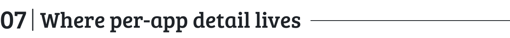</picture></a>

This repository is deliberately app-agnostic. Anything true for only one app belongs in that app's own style guide, not here: its exact token names if they diverge from the reference, class prefixes, measured pixel values, quirks of a specific host UI it runs inside. If the same rule shows up in both places, it gets deleted from the app-specific one: universal belongs here, an exception belongs there.

 

<a id="8-versioning" href="#8-versioning"><picture><source media="(prefers-color-scheme: dark)" srcset=".github/assets/sections/8-versioning-dark.svg">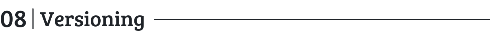</picture></a>

GlimStone the language is versioned independently of any app that adopts it, so a rule added here doesn't imply every adopting app has picked it up yet. See [`CHANGELOG.md`](CHANGELOG.md) for what changed and when.

 

<a id="9-license" href="#9-license"><picture><source media="(prefers-color-scheme: dark)" srcset=".github/assets/sections/9-license-dark.svg">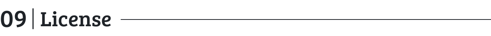</picture></a>

**Copyright (C) 2026 Junker der Provinz.**

GlimStone is free software under the **GNU Affero General Public License v3.0** (AGPL-3.0); see [LICENSE](LICENSE). You may run, study, share and modify it. If you distribute it, or run a modified version as a network service, you must release your source under the same AGPL-3.0 terms and keep the existing copyright and attribution notices intact.

**Name and branding are not licensed.** The AGPL covers the source and documentation only. "GlimStone", its logo and its branding remain reserved: a fork or derivative must use its own distinct name and branding, and may not present itself as GlimStone. This keeps it unambiguous which project is the original.

 

<a id="10-how-ai-is-used-here" href="#10-how-ai-is-used-here"><picture><source media="(prefers-color-scheme: dark)" srcset=".github/assets/sections/10-how-ai-is-used-here-dark.svg">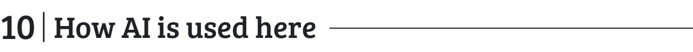</picture></a>

One knight builds this, and AI is one of the tools I work with, the same way I work with an editor or a compiler. It helps me write code and documentation and it checks my work, and that saves me a good many evenings. It does not make the decisions, though. I read and understand everything before it ships, and if something here breaks, that is on me and not on the tool.

You do not have to take my word for it. The code is open and every release note is written by hand. The issue tracker shows how problems actually get handled, including the ones I got wrong the first time. If you find something that is not right, open an issue and I will look at it.

 

Bugs, ideas or questions? Please [open a GitHub issue](https://github.com/junkerderprovinz/glimstone/issues).
